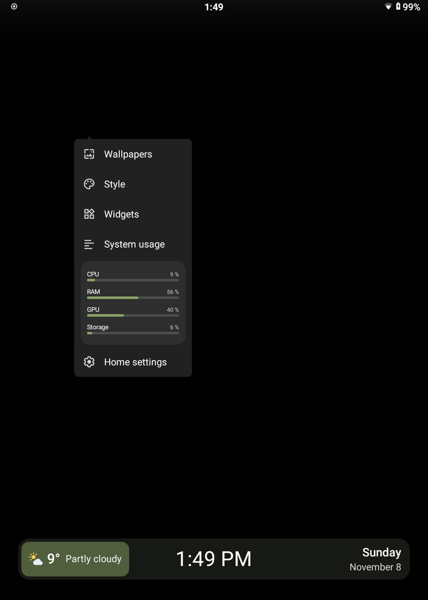
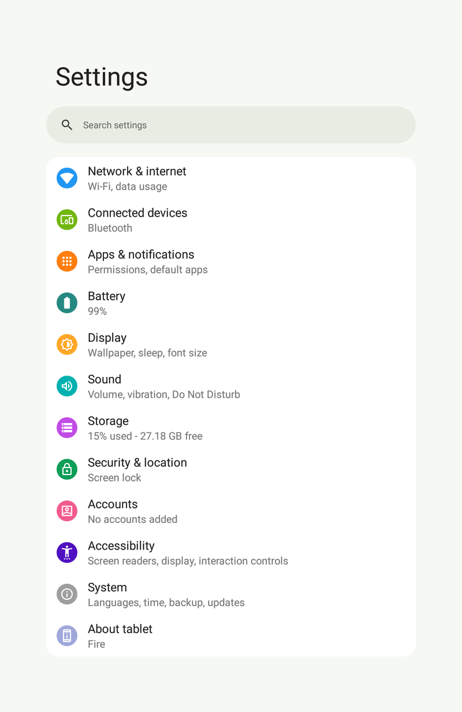
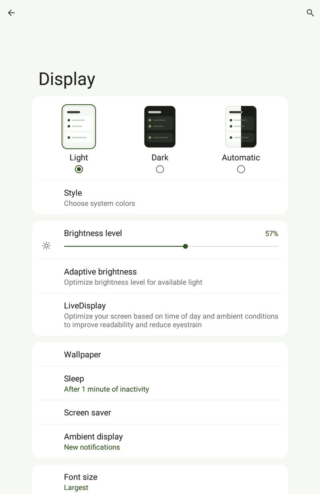
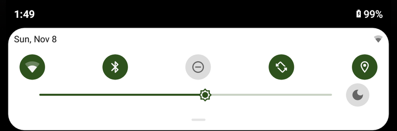

<p align="center"></p>

# ON-FireLOS

A custom ROM for the **Amazon FireHD10 (2017)**, codename `suez`, based on
LineageOS 16 (Android 9).
Tuned so a tablet from 2017 is a pleasure to use again - nearly 10 years
later.

- **Android 9** instead of Fire OS 5
- **New design:** large titles, cards, light and dark
- **Camera** (photo, video), Bluetooth, 5GHz Wi-Fi
- **Chromium 138:** ad blocking, web apps, reader, picture in picture
- **YouTube** smooth up to 1080p
- **Clock with weather**, *Today* widget
- **Gallery** with Immich backup
- **No Google needed:** Droid-ify, Aurora Store
- **No Amazon:** no apps, no lock screen ads
- **System updates** built in with what's new and a version history, tested on my device
- **Fast:** boots in 25s, 1GB compressed RAM
- Game controllers, edge swipes, battery protection
- **ON-FireAI**, a built-in assistant with your own AI server: "Hey Fire"
  recognised offline, even over its own music; timers, reminders, radio, smart
  home; works in apps and in the browser ([more](docs/ONFIREAI.md))

<details>
<summary>What was tuned under the hood</summary>

**CPU**
- Driver bug fixed that kept 2 cores busy
- Apps in front get priority over background work
- Full speed on touch and app start
- Apps start about 20% faster
- Battery saver really slows the CPU down
- System built for this exact CPU

**RAM**
- 1GB extra compressed RAM
- Background apps closed at the right time for 2GB
- Unneeded services removed (telephone, email sync, Google)

**GPU and video**
- Videos decoded in hardware: 1080p60 at 11% CPU
- Web page graphics drawn on the GPU
- A web page that hangs the GPU only closes that page, not the system

**Storage and boot**
- Boots in 25s instead of 55s
- Faster storage access

**Measured on my device:** scrolling at 73c with 1.88% janky frames.
</details>

<p align="center">
  
  
  
</p>
<p align="center">
  
</p>
<p align="center">
  
</p>

## Requirements

- FireHD10 2017 (KFSUWI), **unlocked with TWRP** via
  [amonet](https://xdaforums.com/t/unlock-root-twrp-unbrick-fire-hd-10-2017-suez.3913639/)
- A computer with [`adb`](https://developer.android.com/tools/releases/platform-tools)

## Install

1. Download the ROM from [Releases](../../releases).
2. TWRP: *Wipe → Advanced Wipe → Data* (erases everything).
3. `adb push ON-FireLOS-<version>-suez.zip /tmp/`, then *Install* it.
4. Reboot. The first start takes 5–10min.

Apps come from **Droid-ify** (F-Droid catalogue) and **Aurora Store** (Play
catalogue, anonymously), both built in. No Google account needed.

**Updates:** *Settings → System → System updates* downloads, checks the
signature and installs; apps and data stay. From a build before 2026-11-08:
install the new zip in TWRP, no wipe.

<details>
<summary>Optional: Play Store</summary>

Flash [OpenGApps pico](https://sourceforge.net/projects/opengapps/files/arm64/20220503/)
(`open_gapps-arm64-9.0-pico-20220503.zip`) right after the ROM, before the
first start. Push a `gapps-config.txt` containing `GoogleTTS` to `/tmp/`
first, otherwise it doesn't fit. Then register the device once on Google's
*Uncertified device* page.

**Note:** Google's apps and services need a lot of RAM - about 490MB of
the tablet's 2GB right after a start, measured on my device. Without them
that memory stays free for your apps.
</details>

## Known limits

- No security updates from Google: Android 9, LineageOS 16 and the 3.18 kernel are no longer maintained.
- Chromium 138 is the last WebView for Android 9: no newer engine yet.
- Streaming video may play in SD only (Widevine L1 untested).
- Heavy WebGL pages can freeze the GPU driver;
  large `backdrop-filter: blur` areas make scrolling stutter. Both are limits of
  the PowerVR driver, not fixable in the ROM.
- Untested: USB OTG.

## Build it yourself

Ubuntu 22.04, as root, source tree at `/root/los16`. Create your own signing
keys first (LineageOS wiki: *Signing builds*).

```sh
scripts/setup-buildenv.sh
scripts/sync-sources.sh
scripts/apply-patches.sh
scripts/apply-device-patches.sh
scripts/extract-blobs.sh proprietary-files.txt   # tablet still on Fire OS
device/amazon/suez/extract-files.sh /path/to/stock-dump
scripts/apply-patches.sh
scripts/build-skia-stub.sh
scripts/fetch-androidx-webkit.sh
scripts/fetch-exoplayer.sh
scripts/fetch-store-apps.sh
cd /root/los16 && source build/envsetup.sh && breakfast suez && mka bacon
```

## Credits and licence

[LineageOS](https://github.com/LineageOS), the
[lineage16-suez](https://github.com/lineage16-suez) device tree and kernel,
[amonet](https://github.com/chaosmaster/amonet) (xyzz, chaosmaster and
contributors), TWRP, [OpenGApps](https://opengapps.org). Weather data by
[Open-Meteo.com](https://open-meteo.com) (CC BY 4.0), ad blocking with
[StevenBlack's hosts](https://github.com/StevenBlack/hosts) (MIT). Built in:
[Droid-ify](https://github.com/Droid-ify/client),
[Aurora Store](https://gitlab.com/AuroraOSS/AuroraStore) and
[eSpeak NG](https://github.com/espeak-ng/espeak-ng), each under its own licence
(GPL-3.0), as published on F-Droid.

Own code Apache-2.0 ([LICENSE](LICENSE)), kernel patches GPL-2.0. This
repository holds no proprietary binaries; a build pulls the drivers from your
own tablet. The ROM zip, like any ROM for this device, contains Amazon's and
MediaTek's drivers.
