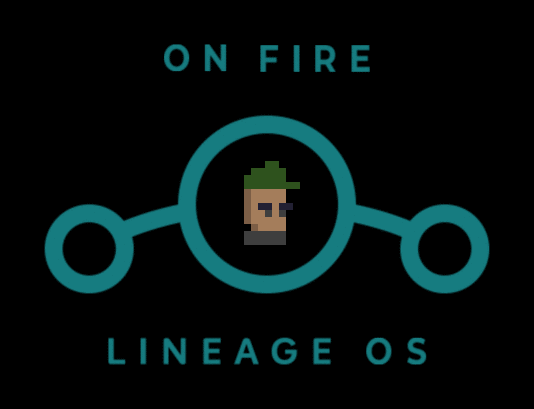
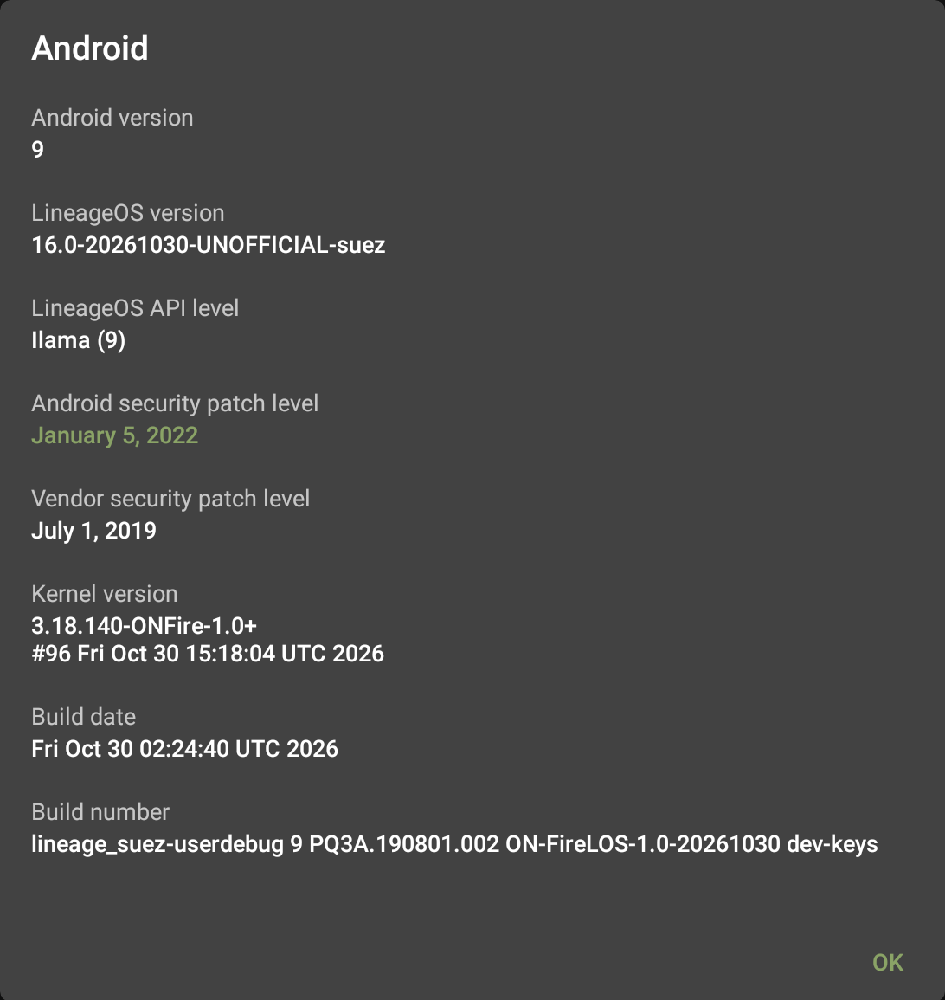

<p align="center"></p>

# ON-FireLOS

A custom ROM for the **Amazon Fire HD 10 (2017)**, codename `suez`, based on
LineageOS 16 (Android 9).

- Android 9 instead of Fire OS 5 (Android 5.1)
- working camera (photo and video), Bluetooth and audio
- Wi-Fi on every 5 GHz channel your country allows
- Chromium 138: ad blocking, web apps, speech, notifications, media controls
- tab overview, reader view with read aloud, per-site settings
- YouTube smooth up to 1080p (H.264)
- web pages draw their canvas on the GPU: animated backgrounds no longer freeze
- context button in the navigation bar: tab count in the browser, camera modes
- Play Store optional, or no Google at all
- no Amazon apps, no lock screen ads
- boots in about 25 s, faster app starts and touch response
- 1 GB compressed RAM tuned for 2 GB: 14 of 15 apps stay open instead of 7
- a web page that hangs the GPU no longer takes the system down
- edge swipes, screenshot and recording tiles, usage widget, magnetic cover
- game controllers over Bluetooth (PS4, Xbox, 8BitDo and more)
- battery protection for tablets that stay plugged in

<p align="center">
  
</p>

## Requirements

- Fire HD 10 2017 (KFSUWI), **unlocked with TWRP** via
  [amonet](https://xdaforums.com/t/unlock-root-twrp-unbrick-fire-hd-10-2017-suez.3913639/)
- A computer with [`adb`](https://developer.android.com/tools/releases/platform-tools)

## Install

1. Download the ROM from [Releases](../../releases).
2. TWRP: *Wipe → Advanced Wipe → Data* (erases everything).
3. `adb push ON-FireLOS-<version>-suez.zip /tmp/`, then *Install* it.
4. Optional Play Store: [OpenGApps pico](https://sourceforge.net/projects/opengapps/files/arm64/20220503/)
   `open_gapps-arm64-9.0-pico-20220503.zip`. Push a `gapps-config.txt` containing
   `GoogleTTS` to `/tmp/` first, otherwise it doesn't fit.
5. Reboot. The 1st start takes 5–10 min.

Without Google: install [F-Droid](https://f-droid.org) and get Aurora Store from it for Play Store apps.

## Known limits

- No security updates from Google: Android 9, LineageOS 16 and the 3.18 kernel are no longer maintained.
- Chromium 138 is the last WebView for Android 9: no newer engine yet.
- Play Store: register the device once on Google's *Uncertified device* page.
- Streaming video may play in SD only (Widevine L1 untested).
- Heavy WebGL pages can freeze the GPU driver;
  large `backdrop-filter: blur` areas make scrolling stutter. Both are limits of
  the PowerVR driver, not fixable in the ROM.
- Untested: USB OTG.

## Build it yourself

Ubuntu 22.04, as root, source tree at `/root/los16`. Create your own signing
keys first (LineageOS wiki: *Signing builds*).

```sh
scripts/setup-buildenv.sh
scripts/sync-sources.sh
scripts/apply-patches.sh
scripts/apply-device-patches.sh
scripts/extract-blobs.sh proprietary-files.txt   # tablet still on Fire OS
device/amazon/suez/extract-files.sh /path/to/stock-dump
scripts/apply-patches.sh
scripts/build-skia-stub.sh
scripts/fetch-androidx-webkit.sh
cd /root/los16 && source build/envsetup.sh && breakfast suez && mka bacon
```

## Credits and licence

[LineageOS](https://github.com/LineageOS), the
[lineage16-suez](https://github.com/lineage16-suez) device tree and kernel,
[amonet](https://github.com/chaosmaster/amonet) (xyzz, chaosmaster and
contributors), TWRP, [OpenGApps](https://opengapps.org).

Own code Apache-2.0 ([LICENSE](LICENSE)), kernel patches GPL-2.0. This
repository holds no proprietary binaries; a build pulls the drivers from your
own tablet. The ROM zip, like any ROM for this device, contains Amazon's and
MediaTek's drivers.
